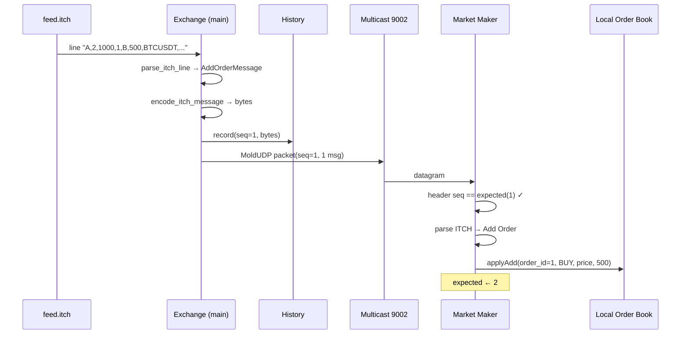
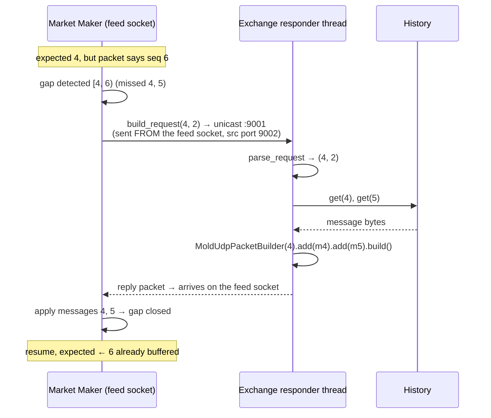

# V3 flow diagrams (draft — pick which to turn into SVG)

Text drafts at three resolutions plus two sequence diagrams. Say which you like and I'll render them as SVG.

---

## Resolution 1 — bird's eye

```
   ┌─────────────────┐   ITCH/MoldUDP feed  ·  multicast 239.1.1.1:9002   ┌─────────────────┐
   │                 │ ─────────────────────────────────────────────────► │                 │
   │     EXCHANGE     │                                                     │   MARKET MAKER   │
   │     (Python)     │ ◄─── retransmission request  ·  unicast :9001 ───── │      (C++)       │
   │                 │ ──── retransmission reply  ·  unicast ─────────────► │                 │
   └─────────────────┘                                                     └─────────────────┘
    turns ITCH text into                                                    rebuilds the order
    a wire feed, serves gaps                                                book from the feed
```

---

## Resolution 2 — components

```
                 EXCHANGE (Python)                        MARKET MAKER (C++)
   ┌───────────────────────────────────┐      ┌───────────────────────────────────┐
   │  feed.itch  (text ITCH lines)      │      │  MoldUDP receiver + gap detect     │
   │        │                           │      │        │                           │
   │        ▼                           │      │        ▼                           │
   │  parse_itch_line → ItchMessage     │      │  ITCH parser → message struct      │
   │        │                           │      │        │                           │
   │        ▼                           │      │        ▼                           │
   │  encode_itch_message → bytes       │      │  local order book (apply-only)     │
   │        │                           │      │        · keyed by order_id          │
   │        ▼                           │      │        · L1 / L2 queries            │
   │  MoldUDP packetizer                │      │                                    │
   │        │           ┌────────────┐  │ feed │                                    │
   │        ├──────────►│  history   │  │═════►│                                    │
   │        ▼           │  buffer    │  │      │                                    │
   │  multicast publisher└─────┬──────┘  │      │                                    │
   │                          ▲         │◄═════│  retransmission client (on gap)    │
   │  retransmission responder┘         │ req  │                                    │
   └───────────────────────────────────┘      └───────────────────────────────────┘
```

---

## Resolution 3 — wire, ports, threads

```
  EXCHANGE (Python)                                          MARKET MAKER (C++)
  ══════════════════════════════════════                    ══════════════════════════════════

  main thread                                                single thread
  ┌────────────────────────────────────┐                    ┌────────────────────────────────┐
  │ for line in feed.itch:              │                    │ loop:                          │
  │   msg   = parse_itch_line(line)     │                    │   pkt = recvfrom(feed socket)  │
  │   bytes = encode_itch_message(msg)  │   MoldUDP packet   │   ┌── bound 0.0.0.0:9002       │
  │   history.record(seq, bytes) ───┐   │   [seq | count |   │   └── joined 239.1.1.1         │
  │   publisher.sendto(               │   │    len+msg ...]   │                                │
  │     239.1.1.1:9002) ─────────────┼───┼══════════════════►│   parse MoldUDP header         │
  │   seq += 1                       │   │   (multicast)      │   expected == seq ?            │
  │                                  ▼   │                    │     yes → parse ITCH → book    │
  │                            ┌──────────┐                   │     no  → gap [expected, seq)  │
  │                            │ history  │                   │            │                   │
  │                            │ {seq:    │                   │            ▼                   │
  │                            │  bytes}  │                   │   build_request(exp, n)        │
  │  responder thread          └────┬─────┘                   │   sendto :9001  ── FROM the    │
  │  ┌──────────────────────┐  get()│                         │      feed socket ──┐           │
  │  │ recvfrom :9001 (block)│◄──────┘                         │                    │           │
  │  │ parse_request(seq,n)  │        unicast request          │                    │           │
  │  │ rebuild MoldUDP pkt    │◄════════════════════════════════════════════════════┘           │
  │  │ sendto(addr) ──────────┼════════════════════════════════►  reply lands on feed socket   │
  │  └──────────────────────┘        unicast reply             │  apply missing, resume        │
  └────────────────────────────────────┘                    └────────────────────────────────┘
       history: single writer (main), single reader (responder), append-only → no lock
```

---

## Sequence 1 — normal feed (happy path)



---

## Sequence 2 — gap detected → retransmission


